<!-- {"layout": "title"} -->
# _Ray tracing_
## Parte 1: verificando colisões

---
<!-- {"layout": "centered"} -->
# Objetivos

1. Relembrar das **limitações de modelos de iluminação local**
1. Conhecer um modelo de iluminação **global**
1. Entender a mecânica geral da técnica de geração de imagens chamada
   _ray tracing_

---
<!-- { "layout": "section-header", "slideClass": "modelos-de-iluminacao", "hash": "modelos-de-iluminacao" } -->
# Modelos de iluminação

- Modelos locais (vimos Phong)
- Modelos globais (veremos hoje)
  - Radiosidade
  - _Ray tracing_
  - _Path tracing_
  - _Photon Mapping_

---
<!-- {"layout": "regular"} -->
# Modelo de iluminação local

- Por ser **mais barato**, é usado para **renderização em tempo real**
  - Exemplos de uso: OpenGL, DirectX
- Apenas caminhos do tipo fonte luminosa → superfície → olho são considerados
  - Interação entre objetos é ignorada, iluminação indireta também
- Como funciona, no _pipeline_ gráfico:
  - No **estágio de geometria**:
    - Para cada vértice de uma cena, a contribuição de cada fonte de luz é
      calculada para se determinar a cor resultante (modelo de iluminação
      de Phong)
  - No **estágio de rasterização**
    - A cor de cada pixel é dada por uma interpolação da cor dos vértices
      (modelo de sombreamento de Gouraud)

---
<!-- {"layout": "regular"} -->
# Efeitos necessários para atingir realismo

-  <!-- {.push-right style="width: 460px"} --> <!-- {ul:.full-width} -->
  Sombras (com penumbra e tudo o mais) ➡️ <!-- {.push-right} -->
- Materiais realísticos (pinturas, vidro) etc.
- Iluminação complexa (natural, luz de área)
-  <!-- {.push-right style="width: 460px; clear: right;"} -->
  Interreflexões ("sangramento" de cor) ↘️
- Reflexão, refração, transparência ⬇️
   <!-- {style="height: 250px;"} -->

---
<!-- {"layout": "centered", "backdrop": "raytraced-realism"} -->
# Modelo de iluminação global

---
<!-- {"layout": "regular"} -->
# Modelo de iluminação global

- Num modelo de iluminação global, consideramos também **a relação
  entre objetos** no cálculo da iluminação
  - Dessa forma, podemos modelar reflexão, refração, sombras e vários dos
    efeitos necessários para a criação de imagens com alto realismo
  - O _pipeline_ gráfico das placas de vídeo não suportam modelos globais
    - Isso porque ele é focado em renderização em tempo real
- Algoritmos para implementar iluminação global:
  1. [1968][ray-tracing] **_Ray tracing_**
  1. [1986][radiosity] Radiosidade <!-- {ol:.layout-split-4.no-bullet style="justify-content: space-around; white-space: nowrap;"} -->
  1. [1986][path-tracing] _Path tracing_
  1. [1996][photon-mapping] _Photon mapping_ 

[radiosity]: https://dl.acm.org/citation.cfm?id=808601
[ray-tracing]: https://dl.acm.org/citation.cfm?id=1468082
[path-tracing]: https://dl.acm.org/citation.cfm?id=15902
[photon-mapping]: https://link.springer.com/chapter/10.1007/978-3-7091-7484-5_3

---
<!-- { "layout": "section-header", "slideClass": "ray-tracing", "hash": "ray-tracing" } -->
# _Ray tracing_

- Tipos:
  1. Simples
  1. Recursivo
  1. Distribuído
- Geração "espontânea" de:
  - Sombras (1/2/3)
  - Objetos transparentes (2/3)
  - Refração (2/3)
  - Reflexões (2/3)

---
<!-- {"layout": "regular"} -->
# _Ray tracing_

- É uma técnica de geração de imagens com alto realismo <!-- {ul:style="margin-bottom: 0"} -->
- Funcionamento **basicão**:
  - Raios são lançados do olho para cada pixel da imagem a ser gerada
  - Raios que acertam objetos
    - são coloridos com sua cor, se estiverem iluminados
    - não são coloridos, se estiverem na sombra
  - Raios que não atingem nada, são pintados com a cor do fundo
  ::: figure .center-aligned
   <!-- {.bullet style="height: 200px;"} -->
   <!-- {.bullet style="height: 200px;"} --> <!-- {p:.no-margin} -->
   <!-- {.bullet style="height: 200px;"} -->
  :::

---


---
<!-- {"layout": "regular"} -->
# Algoritmo basicão

- `pixels[] renderScene(scene)`: <!-- {li:.bullet} -->
  1. Dada uma configuração de câmera, gerar um raio
     <span class="math">R_{ij}</span> que sai do olho, passando pelo centro de cada pixel
     <span class="math">(i, j)</span> da sua janela
  1. Chame `castRay(R)` e assinale a cor do pixel com a cor retornada
- `color castRay(R, scene)`:  <!-- {li:.bullet} -->
  1. Dispara o raio <span class="math">R</span> na cena. Seja <span class="math">X</span> o 1º objeto
    atingido e <span class="math">P</span> o ponto do objeto que foi atingido
  1. Para cada fonte de luz <span class="math">L</span>:
     1. Dispara um raio <span class="math">R_l</span> de <span class="math">P</span> até <span class="math">L</span>
     1. Se <span class="math">R_l</span> não atinge nada até chegar em <span class="math">L</span>, aplique o
        modelo de iluminação para determinar a cor do ponto <span class="math">P</span>
  1. Combine as cores retornadas para cada fonte e retorne a resultante

---
<!-- {"layout": "regular"} -->
# História do _Ray tracing_

-  <!-- {.push-right style="height: 200px"} --> <!-- {ul:.full-width} -->
  Trabalhos seminais:
  - [Appel 68](http://graphics.stanford.edu/courses/Appel.pdf), _ray casting_
  -  <!-- {.push-right style="height: 250px; clear: right;"} -->
    [Whitted 80](http://dl.acm.org/citation.cfm?id=358882), _ray tracing_ recursivo ➡️
- Pesquisa
  - Uso de diferentes primitivas geométricas
  - Técnicas de aceleração
  - Modelos de iluminação mais realistas
  - Interferência do meio (propagação)
- Pesquisas recentes:
  - _Ray tracing_ em tempo real
  - Arquiteturas para _ray tracing_ em _hardware_

---
<!-- {"layout": "regular"} -->
# Algoritmo do _ray tracing_ **recursivo**

- Mantém o método `renderScene(scene)` como está e modifica o
  `castRay(R, scene)` para:
  1. Dispara o raio <span class="math">R</span> na cena. Seja <span class="math">X</span> o 1º objeto atingido e
  <span class="math">P</span> o ponto do objeto que foi atingido
  1. **Se <span class="math">X</span> reflexivo, compute raio de reflexão <span class="math">R_r</span> em
    <span class="math">P</span>. <span class="math">C_r</span> = `castRay(R`<sub>r</sub>`)`**
  1. **Se <span class="math">X</span> transparente, compute raio de refração <span class="math">R_t</span> em
    <span class="math">P</span>. <span class="math">C_t</span> = `castRay(R`<sub>t</sub>`)`**
  1. Para cada fonte de luz <span class="math">L</span>:
     1. Dispara um raio <span class="math">R_l</span> de <span class="math">P</span> até <span class="math">L</span>
     1. Se <span class="math">R_l</span> não atinge nada até chegar em <span class="math">L</span>, aplique o
        modelo de iluminação para determinar a cor do ponto `P`
  1. Combine as cores **<span class="math">C_r</span>, <span class="math">C_t</span>** e das fontes de luz (4) e
    a retorne

---
<!-- { "layout": "regular" } -->
# _Ray tracer_ simples _vs_ recursivo


-  <!-- {.large-width} -->
  Simples (Appel 68)
-  <!-- {.large-width} -->
  Recursivo (Whitted 80) <!-- {ul:.card-list.center-aligned} -->

---
<!-- {"layout": "regular"} -->
# Implementação: perguntas...

- Para implementar um _ray tracer_, precisamos **responder a pelo menos 2
  perguntas**:
  1. Como determinar se um raio atinge um objeto (e em qual)?
     - Semana 1
  1. Dado que um raio atingiu um objeto, como devemos calcular a cor retornada?
     - Semana 2
- Vejamos, primeiro, a representação de raios e sua interseção com objetos

---
<!-- {"layout": "regular"} -->
# Interseção de raio com objeto

- É o coração de um _ray tracer_ (onde ele passa o maior tempo de execução)
  - Foi uma das primeiras áreas de pesquisa
  - Existem rotinas otimizadas para várias primitivas (esferas, toróides, triângulos etc.)
- É necessário calcular diversos tipos de informação:
  - Para **raios primários**: ponto de interseção, material, normal
  - Para _shadow rays_: intercepta/não intercepta
  - Coordenadas de textura
- Mas como **representar um raio**?

---
<!-- {"layout": "regular"} -->
# **Representação** de um **raio**

 <!-- {style="height: 200px;"} -->
<!-- {p:.centered} -->
- **Raio** é uma **semirreta** em forma **paramétrica**:
  <span class="math">R(t) = P_0 + t(P_1 - P_0)</span>, ou seja
  <div class="math">R(t) = P_0 + t\vec{u}</div>
- Computa-se para quais valores do parâmetro <span class="math">t</span> a
  reta intercepta o objeto


---
<!-- {"layout": "regular"} -->
# **Estrutura de dados** para representar raio

- <!-- {ul:.bullet} -->
  Em C:
  ```c
  struct Ray {
    Vector3 P0;
    Vector3 u;
  };


  ```
- Em C++:
  ```cpp
  class Ray {
    public:
    Vector3 P0;
    Vector3 u;
  };

  ```
- Em Java:
  ```java
  public class Ray {
    Vector3 P0;
    Vector3 u;
  }


  ```
- Em JavaScript:
  ```javascript
  class Ray {
    constructor(P0, u) {
      this.P0 = P0;
      this.u = u;
    }
  }
  ```
  <!-- {ul:.layout-split-4.no-bullet style="justify-content: space-around"} -->

E os objetos, como podemos representá-los? <!-- {p:.bullet style="align-self: flex-end;"} -->

---
<!-- {"layout": "regular"} -->
# Objetos implícitos

- Um **objeto implícito** é dado por uma
  **equação da forma <span class="math">F(x, y, z) = 0</span>**
- Várias superfícies podem ser modeladas como objetos implícitos:
  - Planos, círculos, triângulos (grau 1)  <!-- {ul^0:.bulleted} -->
    - _i.e._, <span class="math">ax + by + cz + d = 0</span>
  - Quádricas (grau 2)
    - Elipsóide: <span class="math">\frac{x^2}{a^2}+\frac{y^2}{b^2}+\frac{z^2}{c^2} = 1</span>
    - Cones, Parabolóides, Hiperbolóides...
  - Quárticas (grau 4)
    - Toróides (_dunkin donuts_)

Na vida real: triângulos 👍 <!-- {p:.note.info.centered.bullet} -->


---
<!-- {"layout": "regular"} -->
# Interseção de raio _vs_ objeto implícito

1. Modelamos o **raio** <span class="math">R(t)</span> de forma paramétrica:
   - <span class="math">R(t) = [R_x(t) R_y(t) R_z(t)]</span>
1. Se <span class="math">f(x,y,z)</span> é uma função que representa **um objeto**,
   os pontos de interseção entre o raio e o objeto satisfazem:
   - <span class="math">f(R_x(t),R_y(t),R_z(t)) = 0</span>
   - Repare que substituímos as coordenadas do objeto pelas do raio
1. Com a equação resultante, achamos suas raízes para determinar
   o(s) valor(es) de <span class="math">t</span> que a satisfazem
   - Veja um exemplo com **<span class="math">f(x,y,z)</span> de uma esfera**
     no próximo slide...

---
<!-- {"layout": "regular"} -->
# Exemplo: interseção com esfera

- Primeiramente, vamos **simplificar** o problema e assumir que a **esfera é
  unitária e está centrada na origem**: <!-- {ul:style="max-width: 70%"} -->
  <div class="math">x^2+y^2+z^2 - 1 = 0</div>
- Raio parametrizado como:
  <div class="math">[P_{0x}+t\vec{u}_x \;\;\; P_{0y}+t\vec{u}_y \;\;\; P_{0z}+t\vec{u}_z]</div>

**Atenção**: você NÃO vai usar esta fórmula no trabalho, porque ela serve apenas para
esferas unitárias na origem. <!-- {p:.note.warning style="max-width: 70%; align-self: flex-start;"} -->

---
<!-- {"layout": "regular", "state": "show-active-slide-and-previous"} -->

- Substituindo, <!-- {ul:style="max-width: 86%; align-self: center;"} -->
  <div class="math bullet">(P_{0x}+t\vec{u}_x)^2 + (P_{0y}+t\vec{u}_y)^2 + (P_{0z}+t\vec{u}_z)^2-1=0</div>
  <div class="math bullet" style="font-size: 80%;">(P_{0x}^2+2P_{0x}t\vec{u}_x+t^2\vec{u}_x^2) + (P_{0y}^2+2P_{0y}t\vec{u}_y+t^2\vec{u}_y^2) + (P_{0z}^2+2P_{0z}t\vec{u}_z+t^2\vec{u}_z^2)-1=0</div>
  <div class="math bullet" style="font-size: 80%;">(\vec{u}_x^2+\vec{u}_y^2+\vec{u}_z^2)t^2 + 2(\vec{u}_xP_{0x}+\vec{u}_yP_{0y}+\vec{u}_zP_{0z})t + (P_{0x}^2+P_{0y}^2+P_{0z}^2-1)=0</div>

  - ou <!-- {li:.bullet.no-bullet} -->
    - <span class="math">at^2+bt+c=0</span>
  - <!-- {li:.bullet.no-bullet} -->
    ::: result .note.info.push-right width: 250px;
    - <!-- {li:.bullet} --> 
      <span class="math">\vec{u}</span> é conhecido
    - <!-- {li:.bullet} --> 
      <span class="math">P_0</span> é conhecido
    - <!-- {li:.bullet} --> 
      <span class="math">t</span> é a variável
    :::
  - onde <!-- {li:.bullet.no-bullet} -->
    - <!-- {li:.bullet} -->
      <span class="math">a = \vec{u}_x^2 + \vec{u}_y^2 + \vec{u}_z^2</span>
    - <!-- {li:.bullet} -->
      <span class="math">b = 2(\vec{u}_x P_x + \vec{u}_y P_y + \vec{u}_z P_z)</span>
    - <!-- {li:.bullet} -->
      <span class="math">c = P_{0x}^2 + P_{0y}^2 + P_{0z}^2 - 1</span>
- Com os **coeficientes da equação de 2º grau** (<span class="math">a, b, c</span>),
  podemos encontrar o **<span class="math">\Delta</span>** e **as raízes** (valores 
  de <span class="math">t</span>) <!-- {li:.bullet style="max-width: 720px"} -->

---
<!-- {"layout": "regular-centered"} -->
# Interpretando a interseção com esfera

- Seja <span class="math">\Delta = b^2 - 4ac</span>
  - Então:<br><div class="math">t = \frac{-b \pm \sqrt(\Delta)}{2a}</div> <!-- {ul^1:.no-margin.no-padding.full-width.layout-split-2 style="justify-content: space-around; align-items: center;"} -->
- 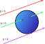 <!-- {li:.no-bullet} -->

Ou seja, para descobrir se o raio interceptou a esfera, **basta resolver
  uma equação de 2º grau** ;)

---
<!-- {"layout": "regular", "slideClass": "esferas-genericas-1", "embeddedStyles": ".esferas-genericas-1 .katex-display { margin-block: 0.6em; }"} -->
# Para **esferas genéricas** (1/4) <!-- {.bullet} -->

- <!-- {ul:.full-width} -->
  Dada uma esfera com centro <span class="math">\textcolor{#5a5ad8}{C}</span> e raio <span class="math">\textcolor{#5a5ad8}{r}</span>
  - Nosso raio: <span class="math">\textcolor{#5a5ad8}{P_0}+\textcolor{#e8691c}{t}\textcolor{#5a5ad8}{\vec{u}}</span>
- Um ponto <span class="math">\textcolor{#e8691c}{Q}</span> está superfície da esfera se sua distância até o centro é igual a <span class="math">\textcolor{#5a5ad8}{r}</span>.<br>Ou seja, <span class="math">\lVert \textcolor{#e8691c}{Q}-\textcolor{#5a5ad8}{C} \rVert=\textcolor{#5a5ad8}{r}</span>. Substituindo o raio no ponto <span class="math">\textcolor{#e8691c}{Q}</span>, temos:
  <div class="math">\lVert (\textcolor{#5a5ad8}{P_0}+\textcolor{#e8691c}{t}\textcolor{#5a5ad8}{\vec{u}})-\textcolor{#5a5ad8}{C} \rVert=\textcolor{#5a5ad8}{r}</div>
- <!-- {li:.no-bullet} -->
  <div class="math">\lVert \textcolor{#e8691c}{t}\textcolor{#5a5ad8}{\vec{u}}-(\textcolor{#5a5ad8}{C}-\textcolor{#5a5ad8}{P_0})\rVert=\textcolor{#5a5ad8}{r}</div>
- <!-- {li:.bullet.full-width} -->
  ::: result .note.info.bullet width: 320px; position: absolute; right: 1rem;
  Se elevarmos a equação ao quadrado:
  <div class="math">\lVert \vec{v} \rVert^2=\vec{v}\cdot\vec{v}</div>
  ::: 
  Para facilitar a álgebra criamos <span class="math">\textcolor{#5a5ad8}{\vec{p}}=\textcolor{#5a5ad8}{C}-\textcolor{#5a5ad8}{P_0}</span>:
  <div class="math">\lVert \textcolor{#e8691c}{t}\textcolor{#5a5ad8}{\vec{u}}-\textcolor{#5a5ad8}{\vec{p}} \rVert=\textcolor{#5a5ad8}{r}</div>
  <div class="math">\lVert \textcolor{#e8691c}{t}\textcolor{#5a5ad8}{\vec{u}}-\textcolor{#5a5ad8}{\vec{p}} \rVert^2=\textcolor{#5a5ad8}{r}^2</div>

---
<!-- {"layout": "regular"} -->
# Para **esferas genéricas** (2/4)

- Conhecemos <span class="math">\textcolor{#5a5ad8}{\textcolor{#5a5ad8}{\vec{u}}}, \textcolor{#5a5ad8}{\vec{p}}</span> e <span class="math">\textcolor{#5a5ad8}{r}</span> e queremos encontrar <span class="math">\textcolor{#e8691c}{t}</span>. Pelo produto interno: <!-- {ul:.bulleted} -->
  <div class="math">(\textcolor{#e8691c}{t}\textcolor{#5a5ad8}{\vec{u}}-\textcolor{#5a5ad8}{\vec{p}})\cdot(\textcolor{#e8691c}{t}\textcolor{#5a5ad8}{\vec{u}}-\textcolor{#5a5ad8}{\vec{p}})=\textcolor{#5a5ad8}{r}^2</div>
- Sabendo que o lado esquerdo resulta em um escalar, podemos distribuir e isolar <span class="math">\textcolor{#e8691c}{t}</span>:
  <div class="math">\textcolor{#e8691c}{t}^2(\textcolor{#5a5ad8}{\vec{u}}\cdot\textcolor{#5a5ad8}{\vec{u}})-2\textcolor{#e8691c}{t}(\textcolor{#5a5ad8}{\vec{u}}\cdot\textcolor{#5a5ad8}{\vec{p}})+(\textcolor{#5a5ad8}{\vec{p}}\cdot\textcolor{#5a5ad8}{\vec{p}})-\textcolor{#5a5ad8}{r}^2=0</div>
- ...que é uma equação do 2º grau e podemos resolver para <span class="math">\textcolor{#e8691c}{t}</span>, afinal:
  - <span class="math">\textcolor{#5a5ad8}{\vec{u}}</span> é conhecido
  - <span class="math">\textcolor{#5a5ad8}{\vec{p}} = \textcolor{#5a5ad8}{C}-\textcolor{#5a5ad8}{P_0}</span> é conhecido
  - <span class="math">\textcolor{#5a5ad8}{r}</span> é conhecido
  - <span class="math">\textcolor{#e8691c}{t}</span> é a variável

---
<!-- {"layout": "regular", "state": "show-active-slide-and-previous"} -->
(3/4) <!-- {.centered} -->

- Da equação quadrática, temos que: <!-- {ul:.bullet style="width: 62%; margin-left: 25%; clear: right;"} -->
  <ul>
    <li><span class="math">a = (\textcolor{#5a5ad8}{\vec{u}}\cdot\textcolor{#5a5ad8}{\vec{u}})=1</span> (se <span class="math">\vec{u}</span> estiver normalizado)</li>
    <li><span class="math">b = -2(\textcolor{#5a5ad8}{\vec{u}}\cdot\textcolor{#5a5ad8}{\vec{p}})</span></li>
    <li><span class="math">c = (\textcolor{#5a5ad8}{\vec{p}}\cdot\textcolor{#5a5ad8}{\vec{p}})-\textcolor{#5a5ad8}{r}^2</span></li>
  </ul>
- Disto, podemos **estudar o sinal do <span class="math">\Delta</span>** para
  saber se há interseção(ões) (raiz(es)) e, caso exista(m), com o
  valor encontrado para <span class="math">\textcolor{#e8691c}{t}</span> podemos **determinar
  o ponto de interseção <span class="math">\textcolor{#e8691c}{Q}</span>** na esfera

Esta é a fórmula que deve ser usada, porque serve para esferas posicionadas em qualquer lugar e com qualquer tamanho. <!-- {p:.note.info.bullet style="max-width: 75%;margin-left:17%;"} -->

---
<!-- { "layout": "regular" } -->
# Estudando o sinal de <span class="math">\Delta</span> e das raízes (4/4)

- <div class="math push-right">t_1=\frac{-b-\sqrt{\Delta}}{2a}</div>
  <div class="math push-right clear-both">t_2=\frac{-b+\sqrt{\Delta}}{2a}</div>
  Se não há raiz real (<span class="math">\Delta<0</span>), não há interseção do raio com a esfera
- Se há uma ou duas raízes reais (<span class="math">\Delta\ge0</span>) <!-- {ul:.bullet} -->
  - Se <span class="math">t_1</span> e <span class="math">t_2</span> são negativas, a esfera está atrás do raio
    - logo, não há interseção
  - Se <span class="math">t_1</span> é negativa e <span class="math">t_2</span> positiva, o raio foi lançado por dentro
    - <span class="math">t = t_2</span> e a normal precisa ser invertida
  - Se <span class="math">t_1</span> e <span class="math">t_2</span> são positivas, a esfera foi atingida pelo raio e
    - <span class="math">t=t_1</span>

**Ou seja**, estamos interessados apenas nos valores de <span class="math">t</span> positivos.
Casa haja dois valores positivos diferentes, pegamos o menor (que será <span class="math">t_1</span>). <!-- {p:.note.info.no-margin.bullet} -->

---
<!-- {"layout": "regular"} -->
# Outras informações da colisão

- Além de determinar se houve colisão ou não, também é necessário descobrir:
  - O ponto de interseção <span class="math">\textcolor{#e8691c}{Q}=\textcolor{#5a5ad8}{P_0}+\textcolor{#5a5ad8}{t\vec{u}} \quad</span> <small style="color: gray">(usando o <span class="math">\textcolor{#5a5ad8}{t}</span> encontrado na equação do raio)</small>
  - O vetor normal do objeto nesse ponto
- ::: figure .push-right.bullet max-width: 550px; display: flex; flex-direction: row; gap: 1rem;
  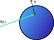
  
  <div class="math">\vec{n}=\begin{bmatrix}\frac{\partial F}{\partial x} \\[5pt] \frac{\partial F}{\partial y} \\[5pt] \frac{\partial F}{\partial z}\end{bmatrix}=\begin{bmatrix}2(x-C_x)\\[5pt]2(y-C_y)\\[5pt]2(z-C_z)\end{bmatrix}</div>
  :::
  A normal no ponto de interseção <span class="math">Q</span> é
  dada pelo gradiente no ponto de interseção ➡️
- <!-- {li:.bullet} -->
  No caso da esfera, **podemos simplesmente** fazer o vetor<div style="display: flex; justify-content: center;"><div class="math">\vec{n}=Q-C,</div><div class="math bullet">\quad \hat{n}=\frac{\vec{n}}{\left|\vec{n}\right|}</div></div>
  <div class="bullet">onde <span class="math">C</span> é o centro da esfera.</div>

---
<!-- {"layout": "regular"} -->
# Implementando um _ray tracer_

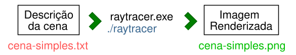 <!-- {p:.no-margin.full-width.center-aligned} -->

- Precisamos de
  1. Utilitário para **Ponto** ou **Vetor**
  1. Uma classe **ObjetoDaCena** com subclasses para cada tipo de sólido
  1. Uma estrutura/classe **FonteDeLuz**
  1. Uma estrutura/classe **Raio**, e outra para **RespostaColisão**
  1. E mais algumas coisinhas...
- **Não precisamos** <!-- {.alternate-color} --> de:
  - De **OpenGL, WebGL ou DirectX** <!-- {.alternate-color} -->, afinal são APIs de rasterização


---
<!-- {"layout": "regular"} -->
## Entrada e saída

- <!-- {ul:.layout-split-2.no-bullet style="gap: 3rem"} -->
  Descrição da cena:
  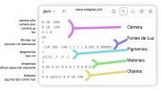

- Saída gerada:
  

---
# Para a próxima aula

- Ler páginas 79, 80 (introdução a raytracing), 83 (representação de raio), 85 e 86 do prof. David Mount
  - Fazer isto => certeza de sucesso, TP resolvido durante a aula
  - Não fazer => TPs incompletos ou mesmo não consegue entregar :/
- Opcional:
  - Colisão de raio com triângulo (páginas 109-112)

---
<!-- { "layout": "regular" } -->
# Colisão com plano

-  <!-- {.push-right style="max-width: 240px"} --> <!-- {ul:.bulleted style="max-width: 80%"} -->
  Seja <span class="math">\textcolor{#5a5ad8}{C}</span> um ponto qualquer no plano e <span class="math">\textcolor{#5a5ad8}{\vec{n}}</span> a normal do plano
- Um ponto <span class="math">\textcolor{#e8691c}{Q}</span> está no plano se o vetor <span class="math">\textcolor{#e8691c}{Q}-\textcolor{#5a5ad8}{C}</span> for perpendicular a <span class="math">\textcolor{#5a5ad8}{\vec{n}}</span>. Ou seja:
  <div class="math">(\textcolor{#e8691c}{Q}-\textcolor{#5a5ad8}{C})\cdot\textcolor{#5a5ad8}{\vec{n}}=0</div>
- Substituindo <span class="math">\textcolor{#e8691c}{Q}</span> pela equação do raio:
  <div class="full-width" style="display: grid; grid-template-rows: auto auto auto auto; grid-template-columns: auto 1fr; grid-column-gap: 1em;">
    <div style="display: flex; justify-content: flex-start; grid-row: 1/2; grid-column: 1/2">
      <span class="math bullet">(\textcolor{#5a5ad8}{P_0}+\textcolor{#e8691c}{t}\textcolor{#5a5ad8}{\vec{u}}-\textcolor{#5a5ad8}{C})\cdot\textcolor{#5a5ad8}{\vec{n}}=0</span>
      <span class="math bullet">\textrm{,} \quad \textcolor{#5a5ad8}{\vec{p}}=\textcolor{#5a5ad8}{C}-\textcolor{#5a5ad8}{P_0}</span>
    </div>
    <small class="bullet" style="color: gray; grid-row: 1/2; grid-column: 2/3">⬅️ fazendo um truque algébrico</small>
    <span class="math bullet" style="grid-row: 2/3; grid-column: 1/2">(\textcolor{#e8691c}{t}\textcolor{#5a5ad8}{\vec{u}}-\textcolor{#5a5ad8}{\vec{p}})\cdot\textcolor{#5a5ad8}{\vec{n}}=0</span>
    <small class="bullet" style="color: gray; grid-row: 2/3; grid-column: 2/3">↙️ distribuindo o produto escalar</small>
    <span class="math bullet" style="grid-row: 3/4; grid-column: 1/2">\textcolor{#e8691c}{t}(\textcolor{#5a5ad8}{\vec{u}}\cdot\textcolor{#5a5ad8}{\vec{n}})-\textcolor{#5a5ad8}{\vec{p}}\cdot\textcolor{#5a5ad8}{\vec{n}}=0</span>
    <small class="bullet" style="color: gray; grid-row: 3/4; grid-column: 2/3">↙️ isolando <span class="math">\textcolor{#e8691c}{t}</span></small>
    <div class="math bullet no-margin centered" style="grid-row: 4/5; grid-column: 1/2;">\textcolor{#e8691c}{t}=\frac{\textcolor{#5a5ad8}{\vec{p}}\cdot\textcolor{#5a5ad8}{\vec{n}}}{\textcolor{#5a5ad8}{\vec{u}}\cdot\textcolor{#5a5ad8}{\vec{n}}}</div>
  </div>

---
<!-- { "layout": "centered", "state": "show-active-slide-and-previous" } -->

- Se: <!-- {ul:.bulleted} -->
  - <span class="math">\vec{u}\cdot\vec{n}\neq0</span>, há 1 interseção
  - <span class="math">\vec{u}\cdot\vec{n}=0</span>,
    - Se <span class="math">\vec{p}\cdot\vec{n}\neq0</span>, sem interseção
    - Se <span class="math">\vec{p}\cdot\vec{n}=0</span>, infinitas interseções

**Atenção**: só interessa o valor de <span class="math">t</span> que seja <span class="math">t>0</span>. <!-- {p:.note.warning.bullet} -->

**Atenção 2**: se raio atingiu "as costas" do plano (ângulo raio/normal>90), precisamos inverter a normal na resposta de colisão <small style="color: gray">(para fins de iluminação)</small>. <!-- {p:.note.warning.bullet style="max-width: 55%"} -->

---
# Colisão com círculo
1. Acha se colide com plano do círculo
1. Verifica se está dentro do raio

---
<!-- {"layout": "regular"} -->
# Colisão com cilindro

-  <!-- {.push-right style="max-width: 240px"} --> <!-- {ul:.bulleted style="max-width: 80%"} -->
  Sejam <span class="math">\textcolor{#5a5ad8}{B}</span> e <span class="math">\textcolor{#5a5ad8}{T}</span> o centro da <u>b</u>ase e <u>t</u>opo do cilindro e <span class="math">\textcolor{#5a5ad8}{r}</span> o seu raio
- Um ponto <span class="math">\textcolor{#e8691c}{Q}</span> está na lateral do cilindro se: <span class="math">\lVert \textcolor{#e8691c}{Q}-\textcolor{#5a5ad8}{B}\rVert^2=\lVert \textcolor{#5a5ad8}{K}-\textcolor{#5a5ad8}{B}\rVert^2+\textcolor{#5a5ad8}{r}^2</span>
- Precisamos descobrir <span class="math">\textcolor{#5a5ad8}{K}</span> em termos do que temos. Considere:
  - O vetor direção do cilindro: <span class="math">\textcolor{#5a5ad8}{\hat{h}}=\frac{\textcolor{#5a5ad8}{T}-\textcolor{#5a5ad8}{B}}{\lVert \textcolor{#5a5ad8}{T}-\textcolor{#5a5ad8}{B}\rVert}</span>
  - Projetando <span class="math">\textcolor{#e8691c}{\overline{QB}}</span> em <span class="math">\textcolor{#5a5ad8}{\hat{h}}</span>, <span class="math">\lVert \textcolor{#5a5ad8}{K}-\textcolor{#5a5ad8}{B}\rVert=(\textcolor{#e8691c}{Q}-\textcolor{#5a5ad8}{B}) \cdot \textcolor{#5a5ad8}{\hat{h}}</span>
- Vamos agora:
  - (a) substituir <span class="math">\lVert \textcolor{#5a5ad8}{K}-\textcolor{#5a5ad8}{B}\rVert</span> na equação do cilindro
  - (b) depois, substituir <span class="math">\textcolor{#e8691c}{Q}</span> pela equação do raio...

---
<!-- {"layout": "centered"} -->

-  <!-- {ul:.layout-split-2.no-bullet style="gap: 1rem; margin-bottom: 0; flex: 0;"} -->
- <div class="full-width bullet" style="display: grid; grid-auto-rows: auto; grid-template-columns: auto 1fr; grid-column-gap: 1em;">
    <span class="math">\lVert \textcolor{#e8691c}{Q}-\textcolor{#5a5ad8}{B}\rVert^2=\lVert \textcolor{#5a5ad8}{K}-\textcolor{#5a5ad8}{B}\rVert^2+\textcolor{#5a5ad8}{r}^2</span>
    <small style="color: gray; grid-row: 1/2; grid-column: 2/3">(0) Equação do cilindro</small>
    <span class="math">\lVert \textcolor{#5a5ad8}{K}-\textcolor{#5a5ad8}{B}\rVert=(\textcolor{#e8691c}{Q}-\textcolor{#5a5ad8}{B}) \cdot \textcolor{#5a5ad8}{\hat{h}}</span>
    <small style="color: gray; grid-row: 2/3; grid-column: 2/3">(a) Tamanho do segmento <span class="math">\textcolor{#5a5ad8}{K}-\textcolor{#5a5ad8}{B}</span></small>
    <span class="math">\textcolor{#5a5ad8}{P_0}+\textcolor{#e8691c}{t}\textcolor{#5a5ad8}{\vec{u}}</span>
    <small style="color: gray; grid-row: 3/4; grid-column: 2/3">(b) Equação do raio, vai substituir <span class="math">\textcolor{#e8691c}{Q}</span></small>
  </div>
  <ul class="no-padding" style="margin-top: 1rem;">
    <li class="bullet">Substituindo (a) em (0):<br>
      <span class="math" style="margin-left: 1rem">\lVert \textcolor{#e8691c}{Q}-\textcolor{#5a5ad8}{B}\rVert^2=[(\textcolor{#e8691c}{Q}-\textcolor{#5a5ad8}{B}) \cdot \textcolor{#5a5ad8}{\hat{h}}]^2+\textcolor{#5a5ad8}{r}^2</span>
    </li>
    <li class="bullet">Substituindo (b) em <span class="math">\textcolor{#e8691c}{Q}</span>:<br>
      <span class="math" style="margin-left: 1rem">\lVert \textcolor{#5a5ad8}{P_0}+\textcolor{#e8691c}{t}\textcolor{#5a5ad8}{\vec{u}}-\textcolor{#5a5ad8}{B}\rVert^2=[(\textcolor{#5a5ad8}{P_0}+\textcolor{#e8691c}{t}\textcolor{#5a5ad8}{\vec{u}}-\textcolor{#5a5ad8}{B}) \cdot \textcolor{#5a5ad8}{\hat{h}}]^2+\textcolor{#5a5ad8}{r}^2</span>
    </li>
  </ul>

1. <!-- {ol:.no-bullet.no-padding.bullet.no-margin} -->
   Resolvendo:
   <div class="full-width" style="display: grid; grid-auto-rows: auto; grid-template-columns: auto 1fr; grid-column-gap: 1em;">
     <span class="math bullet">\textcolor{#5a5ad8}{\vec{w}}=\textcolor{#5a5ad8}{P_0}-\textcolor{#5a5ad8}{B}</span>
     <small class="bullet" style="color: gray; grid-row: 1/2; grid-column: 2/3">⬅️ fazendo um truque algébrico</small>
     <span class="math bullet" style="grid-row: 2/3; grid-column: 1/2">
       \lVert\textcolor{#e8691c}{t}\textcolor{#5a5ad8}{\vec{u}}+\textcolor{#5a5ad8}{\vec{w}}\rVert^2-[(\textcolor{#e8691c}{t}\textcolor{#5a5ad8}{\vec{u}}+\textcolor{#5a5ad8}{\vec{w}})\cdot\textcolor{#5a5ad8}{\hat{h}}]^2=\textcolor{#5a5ad8}{r}^2
     </span>
     <small class="bullet" style="color: gray; grid-row: 2/3; grid-column: 2/3">↙️ norma² == p. escalar</small>
     <span class="math bullet" style="grid-row: 3/4; grid-column: 1/2">
       (\textcolor{#e8691c}{t}\textcolor{#5a5ad8}{\vec{u}}+\textcolor{#5a5ad8}{\vec{w}})\cdot(\textcolor{#e8691c}{t}\textcolor{#5a5ad8}{\vec{u}}+\textcolor{#5a5ad8}{\vec{w}})-[(\textcolor{#5a5ad8}{\vec{u}}\cdot\textcolor{#5a5ad8}{\hat{h}})\textcolor{#e8691c}{t}+(\textcolor{#5a5ad8}{\vec{w}}\cdot\textcolor{#5a5ad8}{\hat{h}})]^2=\textcolor{#5a5ad8}{r}^2
     </span>
     <small class="bullet" style="color: gray; grid-row: 3/4; grid-column: 2/3">↙️ expandindo p. escalar e ²</small>
     <span class="math bullet no-margin left-aligned" style="grid-row: 4/5; grid-column: 1/3;">
        (\textcolor{#5a5ad8}{\vec{u}}\cdot\textcolor{#5a5ad8}{\vec{u}})\textcolor{#e8691c}{t}^2+2(\textcolor{#5a5ad8}{\vec{u}}\cdot\textcolor{#5a5ad8}{\vec{w}})\textcolor{#e8691c}{t}+(\textcolor{#5a5ad8}{\vec{w}}\cdot\textcolor{#5a5ad8}{\vec{w}})-(\textcolor{#5a5ad8}{\vec{u}}\cdot\textcolor{#5a5ad8}{\hat{h}})^2\textcolor{#e8691c}{t}^2-2(\textcolor{#5a5ad8}{\vec{u}}  \cdot\textcolor{#5a5ad8}{\hat{h}})(\textcolor{#5a5ad8}{\vec{w}}\cdot\textcolor{#5a5ad8}{\hat{h}})\textcolor{#e8691c}{t}-(\textcolor{#5a5ad8}{\vec{w}}\cdot\textcolor{#5a5ad8}{\hat{h}})^2=\textcolor{#5a5ad8}{r}^2
     </span>
   </div>
   <li class="bullet">
    Agrupando por coeficientes de potência de <span class="math">\textcolor{#e8691c}{t}</span>:<br>
     <span class="math bullet no-margin left-aligned" style="grid-row: 4/5; grid-column: 1/3;">
        [(\textcolor{#5a5ad8}{\vec{u}}\cdot\textcolor{#5a5ad8}{\vec{u}})-(\textcolor{#5a5ad8}{\vec{u}}\cdot\textcolor{#5a5ad8}{\hat{h}})^2]\textcolor{#e8691c}{t}^2+2[(\textcolor{#5a5ad8}{\vec{u}}\cdot\textcolor{#5a5ad8}{\vec{w}})-(\textcolor{#5a5ad8}{\vec{u}}\cdot\textcolor{#5a5ad8}{\hat{h}})(\textcolor{#5a5ad8}{\vec{w}}\cdot\textcolor{#5a5ad8}{\hat{h}})]\textcolor{#e8691c}{t}+(\textcolor{#5a5ad8}{\vec{w}}\cdot\textcolor{#5a5ad8}{\vec{w}})-(\textcolor{#5a5ad8}{\vec{w}}\cdot\textcolor{#5a5ad8}{\hat{h}})^2-\textcolor{#5a5ad8}{r}^2=0
     </span>
   </li>

---
<!-- {"layout": "center", "state": "show-active-slide-and-previous"} -->

- <!-- {ul:.bullet.no-margin} -->
  Se resolvermos a equação de 2º grau para <span class="math">\textcolor{#e8691c}{t}</span>:
  <div class="math">
  \begin{cases}
    a=(\vec{u}\cdot\vec{u}) - ( \vec{u} \cdot \hat{h})^2 \\
    b=2[(\vec{u}\cdot\vec{w}) - (\vec{u}\cdot\hat{h}) (\vec{w}\cdot\hat{h})] \\
    c=(\vec{w} \cdot \vec{w}) - (\vec{w}\cdot\hat{h})^2 - r^2
  \end{cases}
  </div>

1. <!-- {ol:.bullet style="width: 40%; margin-left: 5rem"} -->
   Se <span class="math">\Delta>0</span>, 2 interseções
1. Se <span class="math">\Delta=0</span>, 1 interseção
1. Se <span class="math">\Delta<0</span>, 0 interseção

<div class="note info no-margin bullet" style="width: 54%; margin-left: 4rem;">
Se houve interseções, interessa aquela com menor <span class="math">t</span> positivo.
Além disso, precisamos considerar o ínicio e fim do cilindro:
<ul style="padding-left: 0.75rem"><li>Se <span class="math">0\leq (Q-B)\cdot\vec{h}\leq\lVert h\rVert</span>, intersectou lateral</li>
<li>Se <span class="math">(Q-B)\cdot\vec{h}\lt 0</span>, testar círculo base</li>
<li>Se <span class="math">(Q-B)\cdot\vec{h}\gt \lVert h\rVert</span>, testar topo</li>
</ul>
</div>

---
<!-- {"layout": "regular"} -->
# Colisão com triângulo

Feita em 2 passos:
1. Verifica se colidiu com o plano, e salva o ponto <span class="math">Q</span>
1. Testa se <span class="math">Q</span> está dentro/fora de cada lado do triângulo

- <!-- {ul:.full-width} -->
  <!-- {li:.no-bullet} -->
  <figure class="picture-steps clean push-left" style="font-size: 0.8em">
    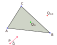 
    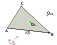 
    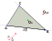 
    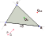 
    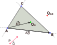 
     
    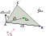 
    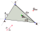 
    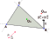 
    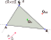 
    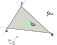 
  </figure>
  
  1. Para o lado <span class="math">\overline{AB}</span>:
  1. a) Acha o vetor <span class="math">\overline{AQ}</span>
  1. b) Produto vetorial do lado <span class="math">\overline{AB}</span> com <span class="math">\overline{AQ}</span>: <span class="math">\overline{AB}\times\overline{AQ}</span>)
  1. c) Vê se aponta para mesmo lado que a normal <span class="math">\vec{n}</span> estudando o sinal de <span class="math">(\overline{AB}\times\overline{AQ})\cdot\vec{n}</span>
  1. d) Faz o mesmo para lados <span class="math">\overline{BC}</span> e <span class="math">\overline{CA}</span>


<!-- (https://www.scratchapixel.com/lessons/3d-basic-rendering/ray-tracing-rendering-a-triangle/ray-triangle-intersection-geometric-solution) -->


---
# Referências

- Aulas 18 e 19 do prof. David Mount (link na página do curso)
- Capítulo 10 do livro **Computer Graphics with OpenGL** de _Hearn and Baker_
- [Disciplina _Ray Tracing for Graphics_](https://graphics.cs.utah.edu/courses/cs6620/fall2025/) da _University of Utah_
  - Uma matéria inteira sobre a criação de _ray tracers_
